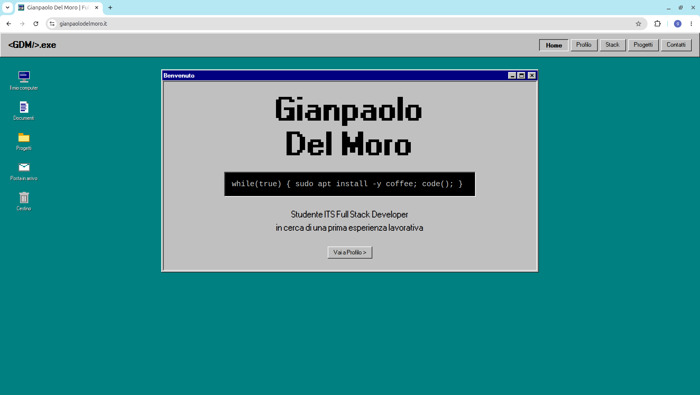

# Portfolio Windows 95

Portfolio personale in single page application, con estetica Windows 95.

**Sito in produzione: [gianpaolodelmoro.it](https://gianpaolodelmoro.it)**



## Cosa dimostra

- Tema MUI custom in `src/theme/theme.js`: bordi 3D `raised`/`sunken` come coppie
  di `boxShadow` inset, con le misure dei controlli derivate da un'unica costante
  `uiScale`.
- Rotte in `lazy()` con un solo `<Suspense>` in `App.jsx`: ogni pagina è un chunk
  separato.
- Accessibilità: `aria-label` e `aria-pressed` sulle icone desktop,
  `role="progressbar"` con `aria-valuenow` nelle barre skill, `focusStyle`
  condiviso per il focus da tastiera su ogni controllo non-MUI.
- Content Security Policy in un `<meta>` di `index.html`, derivata dall'inventario
  reale delle origini: nessun CDN, nessun font remoto, nessuna chiamata di rete.
- Deploy automatico su GitHub Pages, con `dist/404.html` generato dal build come
  fallback per i deep link della SPA.

## Stack

| Pacchetto | Versione |
| --- | --- |
| react / react-dom | ^19.2.7 |
| @mui/material | ^9.2.0 |
| @emotion/react | ^11.14.0 |
| @emotion/styled | ^11.14.1 |
| react-router | ^8.2.0 |
| vite | ^8.1.1 |
| @vitejs/plugin-react | ^6.0.3 |
| oxlint | ^1.71.0 |

JavaScript puro, nessun TypeScript. Nessun file CSS: lo stile passa dal tema MUI
(`src/theme/theme.js`) e dalla prop `sx`.

## Avvio in locale

Richiede Node 20 (la stessa versione usata dalla CI).

```bash
npm install
npm run dev
```

| Comando | Cosa fa |
| --- | --- |
| `npm run dev` | Dev server Vite |
| `npm run build` | Build di produzione in `dist/`, più la copia `dist/404.html` per i deep link |
| `npm run preview` | Serve `dist/` come in produzione |
| `npm run lint` | oxlint |

I deep link (`/profilo`, `/stack`, …) e gli asset con path assoluto si verificano
solo con `npm run build && npm run preview`: il dev server li risolve con regole
proprie e nasconde eventuali rotture.

## Deploy

Automatico su GitHub Pages tramite GitHub Actions
(`.github/workflows/deploy.yml`): ogni push su `main` esegue `npm ci`,
`npm run build` e pubblica `dist/` con `actions/deploy-pages`.
